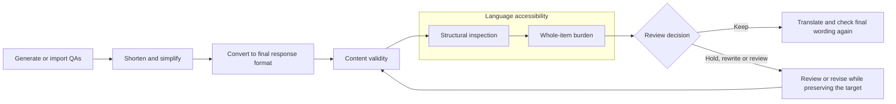

# QA review: content validity and language accessibility

This version organizes the proposed checks into two responsibilities. Language
accessibility has two sequential passes: inspect structure, then assess its effect
on the complete item. Difficulty of the meaning being tested remains descriptive
metadata and cannot compensate for failed wording.

This is a runnable final-review utility for generated or prepared QAs. It writes
review artifacts; it does not rewrite, remove or release questions. The historical
Gold72/Hard66 generation pipelines and published experiment outputs are unchanged.
The revised prompts require calibration; results from the earlier prompts are not
validation of this new combination.

For early simplification before detailed burden analysis, use the newer
[target-first simplification workflow](../qa_simplify_v3/README.md). It processes
every supplied final-language item, removes dispensable setup under a frozen
target contract, and reserves detailed language diagnostics for failures.

For strict wording-only revisions driven by these review results, use the separate
[targeted rewrite workflow](TARGETED_REWRITE.md). It proposes question/option edits,
checks meaning preservation, and reruns all three review passes twice before
exporting an accepted revision. This reviewer itself still only writes judgments.

## Workflow



Run all three passes even when content fails, so one review records both content
and wording problems. Do not infer that passing these model checks demonstrates
good performance with human respondents on a clean passage.

## Responsibility boundaries

| Owner | Checks | Does not decide |
|---|---|---|
| Content validity | Target preservation; question and answer support; one defensible answer; sufficient event/reference context; answer leakage; MCQ key and alternatives | Naturalness, syntax burden, excess wording |
| Structural inspection, within accessibility | Nesting, delayed query, role tracking, reference chains, layered speech, negation scope, overlapping options; exact phrases and required operations | Overall keep/rewrite, grounding, leakage, naturalness score |
| Whole-item burden, within accessibility | Naturalness, avoidable processing demand, excess context; the effect of every structural feature | Answer correctness, missing context, answer leakage |
| Descriptive meaning profile | Answer explicitness, semantic relation, answer scope, passage span | Admission or a combined easy/medium/hard score |

A construction is not automatically a problem. The structural pass must explain
a concrete potentially avoidable load to flag a concern. The burden pass examines
that evidence and can disagree. The intended meaning may legitimately be causal,
temporal, conditional, negative or involve multiple participants.

The content judge identifies the target before either language pass. An explicit
target supplied by the researcher is preserved verbatim for both language passes.
When the target is inferred, the output says so; that inference cannot establish
that the question preserves the original research intention.

## Consolidating the existing checks

| Existing function | Place in the organized workflow |
|---|---|
| Relevance, coverage and deduplication | Keep upstream as question-set selection; distinct from final QA validity |
| Shortening and lexical simplification | Keep upstream as editing; final review verifies the resulting wording |
| UW recoverability / question pointing / relation matching | Consolidate under content validity for final admission; avoid another final broad “difficulty” rejection |
| Hard answer readings, answer support, answer certainty | Content-validity evidence; compare final wording against the actual clean participant window |
| Hard naturalness verdict and “mentally reword” rule | Consolidate under the final naturalness assessment |
| Existing question-complexity score | Historical metadata; use structural evidence and burden ratings for new wording decisions |
| Answer leakage checks in both proposed prompts | One content-validity check; remove leakage verdicts from language passes |
| Missing event anchor / multiple plausible referents | Content validity owns sufficiency; accessibility owns effort needed to decode otherwise resolvable wording |
| Unnecessary setup | Accessibility owns context economy |
| Supporting-verse extraction | Keep as evidence provenance; quoted evidence alone does not establish uniqueness or accessibility |
| Hard structure dependence / corruption sensitivity / location-cue rules | Separate research-design checks; do not equate a useful event anchor with revealing the answer |

Early candidate selection may still use inexpensive validity checks. Rechecking
after rewriting, response-format conversion, translation or window changes is
useful because the evaluated item has changed. Repeating equivalent verdicts on
unchanged wording should not create multiple votes for the same defect.

The table is the migration map for the legacy generators. This utility does not
silently remove their existing safeguards or alter their selection/ranking rules.

## Decisions

- **KEEP:** all applicable content checks pass, every language score is below 2,
  and no unresolved structural concern remains.
- **HOLD_CONTENT:** at least one content check fails. Preserve the item and reasons
  for correction or researcher review; do not silently delete it.
- **REWRITE:** at least one language dimension scores 2 or 3. Keep the intended
  target fixed, revise the wording, then rerun both responsibilities.
- **REVIEW:** uncertain content, a structural concern with passing burden scores,
  unresolved feature assessment, or disagreement between repeated evaluations.
- **Incomplete review:** missing, duplicated or unexpected IDs, invalid output,
  refusal or a failed request cannot become a pass. The report marks affected
  items for review and the command exits unsuccessfully.

Content and language decisions are both retained when both fail. No averaging
across dimensions, no majority vote that hides a disagreement, and no difficulty
score that offsets a failure. Ratings and the threshold of 2 are operational
choices, not validated measurements of respondent difficulty.

## Input and use

Each item supplies the exact final respondent-facing question, including its
introduction, plus the full options when applicable. Supply the **clean** passage
window the participant sees, not a deliberately damaged experimental variant.
Expected answers, targets and original wording are private judge metadata.

```json
[
  {
    "id": "example:open:zh",
    "form": "open",
    "question": "是谁把书搬进屋里的？",
    "passage": "下雨了，小林把书搬进屋里。小周留在门口。",
    "expected_answer": "小林",
    "intended_target": "Identify who moved the books inside.",
    "options": {},
    "correct_option": ""
  }
]
```

For MCQ use `form: "mcq"`, a label-to-text options object, and `correct_option`.
Optional `original_question` and `original_answer` support a preservation check
after an edit or translation. Without an original or explicit target, preservation
is marked not applicable. Old scores and provisional concern labels are not sent
to judges. Model-facing IDs are anonymized to avoid labels such as “repair”.

From the repository root:

```bash
python3 evaluation/scripts/analysis/review_qa_items.py \
  --input evaluation/configs/qa_review_v2/smoke_cases.json \
  --output-dir evaluation/reports/my_qa_review \
  --review-stage final_translation --repeats 2 --batch-size 12
```

Use `--prepare-only` for an input check without model calls. Supply
`OPENAI_API_KEY` through the environment or `--env-file PATH`. The default model
matches the preceding experiments, `gpt-6.1-sol`; `--model` can override it.
The API uses [structured outputs](https://developers.openai.com/api/docs/guides/structured-outputs),
followed by local ID, applicability, quotation and feature-coverage validation.

Review the final source form, then the final translated form, then any revision.
Each form requires its own explicit input with its matching clean passage. The
utility does not intercept translation jobs automatically. Input and prompt
fingerprints prevent reusing cached judgments for changed wording, options,
answer keys, targets or passage windows. Use a new output directory for changes.

Outputs include the normalized cases, anonymization map, versioned manifest,
raw structured responses and usage, per-repeat decisions, combined results and
`report.md`. Historical generation datasets remain untouched.

## Validation

`evaluation/tests/test_qa_review.py` tests decision precedence, separate ownership,
missing/duplicate results, applicability, preservation of explicit targets,
structural quotation evidence, disagreement and incomplete-review handling.
These tests exercise software contracts, not linguistic accuracy.

`smoke_cases.json` contains 12 unchanged diagnostic items from the previous prompt
experiment, including original/split/direct handkerchief questions, controls,
content-only defects and known wording concerns. The smoke run is an integration
check, not a held-out accuracy evaluation. The cases mix languages and response
formats; do not infer language or dataset superiority from their decisions.

The [2026-10-27 smoke review](../../reports/qa_review_v2_smoke_2026-10-27/report.md)
completed all six judge calls: 12 items, two repeats, three passes per repeat.
Both repeats agreed on all final decisions: five keep, four rewrite, two content
holds and one review. Both Chinese handkerchief variants were held for rewriting;
the concise outcome question passed. The English split version remained a review
case because structural concerns persisted despite passing burden ratings. The
constructed leakage and missing-anchor problems were assigned to content validity.
This confirms the workflow runs and records distinct issue types on these examples;
it does not establish general accuracy or a human-validated burden threshold.
