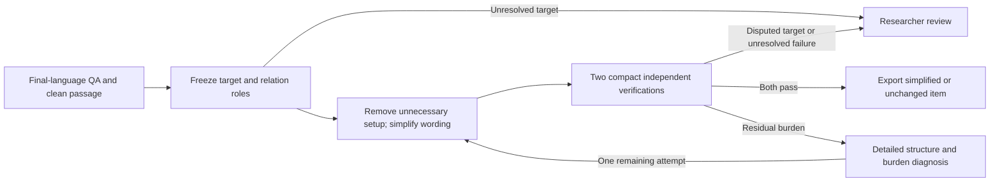

# Early QA simplification

Version 3.1 is the target-first workflow for generated or prepared questions. Run it on
final source wording and again on final translated wording with the actual clean
participant passage. English acceptance does not validate a Chinese translation.
Unlike the v2 rewrite queue, it processes every supplied item without requiring a
prior burden flag. Previous scripts, prompts and completed runs remain unchanged.



## What changed

The target planner distinguishes the tested meaning, necessary event anchors,
removable setup, and unresolved relations. A question can ask who escaped injured
without also testing every preceding event used in the original introduction.
An explicit research target can instead require that preceding relationship.
Required temporal conditions, causes, polarity, scope and answer components remain
protected. The same expected answer is not sufficient evidence of preservation.

The writer can remove relations marked removable and simplify question/options.
It does not merely distribute the same narrative over several sentences. Clear
items can remain unchanged. It cannot edit the answer, key, passage, labels, form,
explicit target, or source metadata. Every option must retain its meaning.

Each compact verifier independently checks the provisional contract, target and
removal validity, language, all option meanings, content support, uniqueness,
context, leakage, and whole-item naturalness/processing/context economy. It sees
neither writer rationale nor previous verdicts. Redundant event narration or an
avoidable reference chain can fail context economy even when each clause is
grammatical and each pronoun individually resolvable. Language ratings apply only
to the candidate question/options, never to the passage stimulus. Every nonzero
rating must quote matching candidate wording; passage-only evidence is rejected.

The usual path is four model calls: target, simplification, and two compact
verifications. Detailed v2 structure/burden calls run only after a residual
language failure. Content/preservation feedback can go directly to the next
proposal. A disputed contract stops for review rather than being redefined by the
writer. There are at most two proposals; identical failed wording is not rejudged
until it passes. Missing checks, uncertainty and API errors cannot yield acceptance.

Inferred targets remain marked inferred in the audit and are never silently
written into `intended_target`. These decisions are model-screening evidence,
not researcher approval of inferred targets or human comprehension validation.

## Use

Inputs use the normalized JSON case format accepted by `review_qa_items.py`:
`id`, `question`, `passage`, `expected_answer`, `form`, plus MCQ `options` and
`correct_option`; optional `intended_target`, `original_question`, `original_answer`.
Use the exact displayed language and passage window, not a translated proxy.

```bash
python3 evaluation/scripts/analysis/simplify_qa_items.py \
  --input evaluation/configs/qa_simplify_v3/validation_cases.json \
  --output-dir evaluation/reports/qa_early_simplify_validation_v3_1_2026-10-27 \
  --workers 4 \
  --env-file '/Users/louiscao/bible translation/ETEN-Bible-translation-project/v3/combo/qa_generation/.env'
```

`--prepare-only` freezes inputs without model calls. Repeat `--input` to combine
files (IDs must be unique), or use `--id`/`--limit` for subsets. The default model
is `gpt-6.1-sol`; `--model` overrides it. Rerunning identical inputs/settings/code
resumes from response caches. Changed criteria require a new output directory.

For all previously bound English Gold and Chinese Hard forms, supply their
`qa_review_v2_full_2026-10-27/gold/cases.json` and `hard/cases.json` files to a new
output directory. Chinese Gold requires its own translated inputs; it is not
included in that English Gold file. The focused validation run is not a full
corpus rerun or a dataset promotion.

## Outputs

- `results.json`: original, frozen contract, every proposal, checks and diagnostics.
- `ready_cases.json`: all passing items, including unchanged ones.
- `rewritten_cases.json`: only accepted changes.
- `summary.json` and `report.md`: counts and before/after evidence.
- `items/`: individual checkpoints and response caches, including usage metadata.
- `manifest.json`: fingerprints of inputs, scripts, prompts, settings and schemas.

Statuses: `SIMPLIFIED`, `KEPT`, `HOLD_TARGET`, `DECLINED`, `REVIEW`, or `ERROR`.
Only the first two export a ready case. Original datasets are never overwritten.
API errors exit unsuccessfully; held or declined research cases are valid outcomes.

## Validation

`evaluation/tests/test_early_qa_simplification.py` tests stage ordering, diagnostics
only after failure, bounded retries, protected metadata and relation IDs, option
semantics, complete repeated judgments, caching, and safe output paths.

`validation_cases.json` contains 12 focused examples and controls. Expectations
and provenance are separate in `validation_expectations.json`, which is NOT sent
to the model. Both inferred and user-confirmed escapee targets are tested. The
preferred Chinese wording is withheld from generation and verification prompts.
These development examples are not a held-out estimate of general accuracy.

Calls use the repository's existing Responses API transport and strict schemas,
following the [official OpenAI Structured Outputs documentation](https://developers.openai.com/api/docs/guides/structured-outputs).
